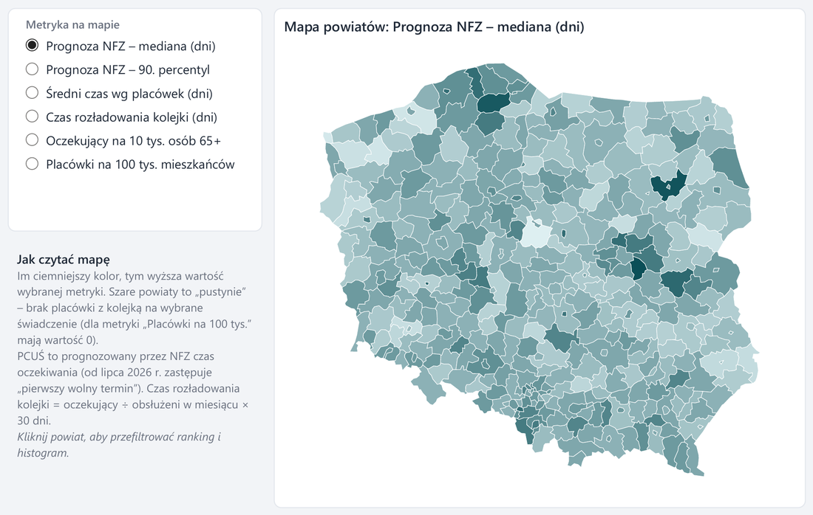
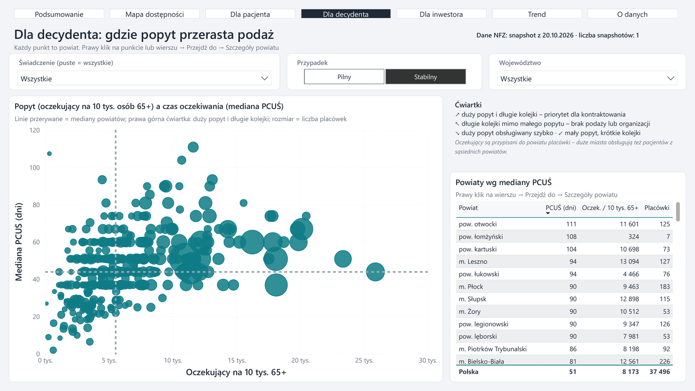
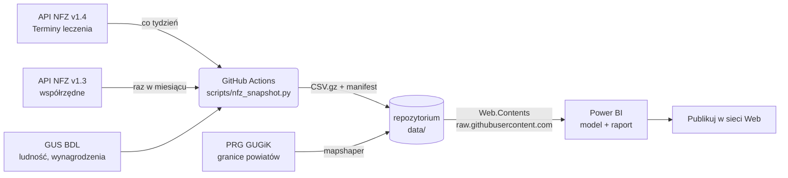

# Gdzie w Polsce czeka się najkrócej?

Raport Power BI o dostępności leczenia w ramach NFZ w 380 powiatach: gdzie kolejki są najkrótsze, gdzie popyt przerasta podaż i gdzie brakuje placówek. Dane co tydzień zbiera GitHub Actions z publicznego API NFZ „Terminy leczenia”, a raport czyta je bezpośrednio z tego repozytorium – bez bramy danych i bez ręcznej pracy.

<!-- Po publikacji w usłudze Power BI dodaj tu link, np.: **Raport online:** https://app.powerbi.com/view?r=... -->

**Projekt Power BI:** [`powerbi/GdzieNajkrocej.pbip`](powerbi/GdzieNajkrocej.pbip) – otwórz w bezpłatnym Power BI Desktop i kliknij *Odśwież*. Dane pobierają się z tego repozytorium bez logowania.



## Najważniejsze wnioski

Snapshot z 20.10.2026, przypadki stabilne, mediana prognozowanego czasu oczekiwania (PCUŚ):

- **51 dni** w całej Polsce (przypadki pilne: 37 dni). Mediany województw wynoszą od 37 dni (lubelskie) do 60 dni.
- **Ok. 30% kolejek stabilnych i ponad połowa pilnych jest pusta** – 0 oczekujących i 0 obsłużonych w ostatnim miesiącu. NFZ podaje dla nich PCUŚ 0 dni, więc bez ich pominięcia mediana spadłaby do 21 dni, a dla przypadków pilnych do 0.
- **Najdłużej czeka się** na rehabilitację ogólnoustrojową w warunkach stacjonarnych i poradnię neurochirurgiczną (mediana 300 dni) oraz na endoprotezoplastykę stawu kolanowego (291 dni).
- **Najdłuższa mediana wśród powiatów:** powiat otwocki – 111 dni.

Raport zawsze pokazuje stan z najnowszego snapshotu, więc liczby zmieniają się co tydzień.

## Strony raportu

1. **Podsumowanie** – 3 karty KPI, 3 wnioski generowane miarami, top 10 świadczeń i mediana wg województw.
2. **Mapa dostępności** – kartogram powiatów z przełączaną metryką, ranking powiatów i histogram PCUŚ.
3. **Dla pacjenta** – miejscowość i promień, tabela placówek w zasięgu od najkrótszego czasu oraz mapa bąbelkowa.
4. **Dla decydenta** – wykres punktowy powiatów (popyt × czas, rozmiar = liczba placówek) z ćwiartkami wyznaczonymi przez mediany. Przejście do strony powiatu.
5. **Dla inwestora** – ranking powiatów wg indeksu luki dla wybranej specjalizacji oraz lista „pustyń”.
6. **Trend** – mediana PCUŚ w kolejnych snapshotach (stabilne i pilne zawsze rozdzielone) i zmiana m/m wg województw.
7. **O danych** – źródła, definicje, wskaźniki jakości danych i porównanie średniej z medianą.
8. **Szczegóły powiatu** (ukryta, drill-through) – placówki i świadczenia w wybranym powiecie.



## Jak to działa



- **Pobieranie:** skrypty w Pythonie odpytują API NFZ v1.4 (16 oddziałów × 2 przypadki, ok. 6 tys. zapytań) i zapisują tygodniowy snapshot jako CSV.gz. Raz w miesiącu uzupełniają współrzędne placówek z API v1.3, a dane o ludności i wynagrodzeniach pobierają z GUS BDL.
- **Automatyzacja:** GitHub Actions w poniedziałki rano uruchamia testy, potem pobieranie, i zapisuje wynik w `data/`.
- **Model:** Power Query czyta pliki z `raw.githubusercontent.com` przez `Web.Contents` ze stałym adresem bazowym, dzięki czemu działa zaplanowane odświeżanie w usłudze Power BI. Schemat gwiazdy i ponad 50 miar DAX z opisami.

## Wyzwania i decyzje projektowe

| Problem | Rozwiązanie |
|---|---|
| Od 1.07.2026 NFZ nie publikuje pierwszego wolnego terminu, tylko prognozę (PCUŚ) jako tekst, np. „1 mies. 3 tyg.” | Parser PCUŚ na dni (miesiąc = 30, tydzień = 7) i dwie dodatkowe metryki: średni czas deklarowany przez placówki oraz czas rozładowania kolejki |
| Od 10.07.2026 działa API v1.4, a v1.3 jest oznaczone jako nieaktualne | Snapshot z v1.4; v1.3 służy tylko do uzupełniania współrzędnych |
| Limit 10 zapytań na 10 sekund przy ok. 6 tys. zapytań na snapshot | Wspólne tempo 0,9 zapytania/s dla wszystkich wątków, wspólna pauza po HTTP 429 i dogrywka brakujących stron. Snapshot jest zapisywany, gdy brakuje najwyżej 1% stron |
| Ok. 30% kolejek stabilnych i ponad połowa pilnych nie ma pacjentów, a NFZ podaje dla nich PCUŚ 0 dni | Flaga `KolejkaAktywna`: mediany, mapa i rankingi pomijają puste kolejki (mediana 51 dni zamiast 21). Strona „Dla pacjenta” pokazuje wszystkie placówki |
| W v1.4 większość rekordów nie ma współrzędnych, a część ma je zamienione. v1.3 je podaje, ale poprzedza adres cechą ulicy („UL. DŁUGA 5”), więc klucze miejsc się nie zgadzają | Walidacja i zamiana współrzędnych; dopasowanie z v1.3 po kluczu miejsca (także w wariancie z cechą ulicy), adresie w gminie i kodach komórki organizacyjnej; w ostateczności środek gminy. Dokładną lokalizację ma 89% placówek (wcześniej 54%) |
| Kolejki w centralnej e-rejestracji nie mają w API PCUŚ ani statystyk | Flaga `WCeR` i udział takich kolejek na stronie „O danych” |
| W usłudze Power BI zapytania referencyjne pobierają dane wielokrotnie, a łączenie zapytań sieciowych uruchamia zaporę prywatności | Wymiary (`miejsca.csv.gz`, `swiadczenia.csv`) buduje skrypt; Power Query czyta każdy plik w jednym samodzielnym zapytaniu |
| DAX nie pozwala na miarę w filtrze logicznym `CALCULATE`, a filtr promienia traktował brak odległości jak 0 km | Miary oparte na zmiennych; filtr promienia pomija placówki bez współrzędnych |

## Model danych

Schemat gwiazdy (import):

- **FactKolejki** – ziarno: snapshot × miejsce × świadczenie × przypadek. Zawiera PCUŚ (tekst i dni), oczekujących, skreślonych, średni czas, czas rozładowania oraz flagi `BrakPCUS`, `DaneNieaktualne`, `WCeR`, `WieleMiejsc` i `KolejkaAktywna` (FAŁSZ = kolejka bez pacjentów, pomijana w miarach porównawczych).
- **DimData** – kalendarz oznaczony jako tabela dat.
- **DimPlacowka** – świadczeniodawca i miejsce, adres, telefon, udogodnienia, współrzędne ze źródłem lokalizacji, powiat i województwo.
- **DimSwiadczenie** – nazwa, kategoria (z początku nazwy, w Power Query) i flaga „dla dzieci”.
- **DimPowiat** – 380 powiatów z PRG plus GUS BDL. Relacja 1→* z DimPlacowka, więc powiaty bez placówek („pustynie”) też są widoczne.
- Tabele rozłączne: **ParamPromien** (what-if 5–200 km), **ParamStart** (miejscowości ze środkiem = średnia współrzędnych placówek) i **ParamMetryka** (parametr pól przełączający metrykę mapy i rankingu).
- **Miary** – ponad 50 miar w folderach wyświetlania, każda z opisem.

Kluczowe miary: `Mediana PCUŚ (aktualnie)`, `P90 PCUŚ (aktualnie)`, `Mediana średniego czasu (aktualnie)`, `Czas rozładowania kolejki (aktualnie)`, `Oczekujący na 10 tys. 65+`, `Placówki na 100 tys.`, `Odległość (km)` (haversine), `W promieniu`, `Najkrótszy PCUŚ w promieniu (dni)`, `Indeks luki`, `Zmiana m/m (dni)` oraz miary tekstowe z wnioskami.

## Struktura repozytorium

```
.github/workflows/snapshot-nfz.yml   cotygodniowy snapshot (cron) + uruchomienie ręczne
scripts/
  nfz_api.py                 klient API (wspólne tempo, pauza po 429, dogrywka) i spłaszczanie JSON
  nfz_snapshot.py            16 oddziałów × 2 przypadki, stronicowanie → snapshot
  nfz_wspolrzedne_v13.py     współrzędne placówek z API v1.3
  gus_powiaty.py             GUS BDL: ludność, ludność 65+, przeciętne wynagrodzenie
  geo_build.py               granice powiatów (PRG) → TopoJSON + środki gmin
  ustaw_repo.py              wpisuje adres Twojego repozytorium w projekcie Power BI
  zapisz_dane.sh             commit i push folderu data/ (krok workflow)
  common.py                  wspólne funkcje (TERYT, PCUŚ, CSV)
tests/                       testy jednostkowe i end-to-end na odpowiedziach o strukturze API
data/
  nfz/manifest.csv           lista snapshotów (czyta ją Power BI)
  nfz/snapshots/RRRR-MM-DD.csv.gz
  nfz/miejsca.csv.gz         wymiar miejsc udzielania świadczeń
  nfz/swiadczenia.csv        wymiar świadczeń
  gus/powiaty_gus.csv
  geo/powiaty.topojson       mapa do Shape Map (380 powiatów)
  geo/powiaty.csv            lista powiatów z kodami TERYT
  geo/gminy_centroidy.csv    zapasowa lokalizacja placówek
powerbi/
  GdzieNajkrocej.pbip        ← otwierasz ten plik w Power BI Desktop
  GdzieNajkrocej.SemanticModel/   model (TMDL)
  GdzieNajkrocej.Report/          raport (PBIR)
docs/                        zrzuty ekranu do README
```

## Uruchomienie u siebie

**Wymagania:** konto GitHub, Power BI Desktop z **września 2026 lub nowszy** (format PBIP/PBIR jest od tej wersji domyślny), opcjonalnie Python 3.10+.

1. **Utwórz publiczne repozytorium** na GitHubie, np. `gdzie-czeka-sie-najkrocej`, i wgraj do niego zawartość tego folderu (GitHub Desktop: *Add local repository* → *Publish*, z odznaczonym „Keep this code private”). Repozytorium musi być publiczne, bo raport pobiera dane bez logowania.
2. **Wpisz adres repozytorium w projekcie** (przy zamkniętym Power BI Desktop):
   ```
   python scripts/ustaw_repo.py TWOJ-LOGIN/gdzie-czeka-sie-najkrocej
   ```
   Skrypt ustawia parametry Power Query, adres mapy powiatów i linki. Bez Pythona: w Power BI *Przekształć dane → Parametry* oraz Format mapy → *Ustawienia mapy → Adres URL*. Wypchnij zmianę na GitHuba.
3. **Zbierz pierwszy snapshot:** zakładka *Actions* → „Snapshot kolejek NFZ” → *Run workflow* (zaznacz „Odśwież też dane GUS”). API NFZ v1.4 przyjmuje najwyżej 10 zapytań na 10 sekund, więc pierwszy przebieg trwa do ok. 2,5 godziny, a cotygodniowy ok. 2 godzin. Wynik sprawdzisz w `data/nfz/ostatni_przebieg.json`. Kolejne uruchomienia odbywają się automatycznie w poniedziałki rano.
   - Lokalnie zamiast Actions: `pip install -r requirements.txt`, potem `python scripts/gus_powiaty.py`, `python scripts/nfz_wspolrzedne_v13.py`, `python scripts/nfz_snapshot.py` i wypchnięcie folderu `data/`.
4. **Otwórz `powerbi/GdzieNajkrocej.pbip`** i kliknij *Odśwież*. Przy pytaniu o dostęp do `https://raw.githubusercontent.com` wybierz *Anonimowy*.
5. **Sprawdź mapę na stronie „Mapa dostępności”.** Jeśli powiaty się nie rysują, wybierz w formacie mapy *Ustawienia mapy → Typ mapy: mapa niestandardowa* i wskaż plik `data/geo/powiaty.topojson`, a następnie zapisz projekt. Mapa zostanie wtedy osadzona w raporcie i nie będzie zależna od GitHuba.
6. **Opublikuj:** *Publikuj → Mój obszar roboczy*. W ustawieniach modelu semantycznego ustaw poświadczenia źródła na *Anonimowe* z poziomem prywatności *Publiczny* i zaznacz *Pomiń test połączenia*. Zaplanuj odświeżanie (np. poniedziałki 10:00, po workflow). Potem *Plik → Osadź raport → Publikuj w sieci Web*.

> Kod do „Publikuj w sieci Web” może utworzyć tylko użytkownik z licencją Power BI Pro lub Premium Per User, a funkcję musi dopuszczać administrator dzierżawy (w kontach uczelnianych bywa wyłączona). Usługa Power BI wymaga konta służbowego lub szkolnego. Bez publikacji raport nadal działa w Power BI Desktop.

## Testy i przebudowa mapy

```
python -m unittest discover -s tests -v
python scripts/geo_build.py          # wymaga: pip install shapely, Node.js (mapshaper przez npx)
```

## Źródła danych i licencja

- NFZ, „Terminy leczenia” – API v1.4 (`apinfz.nfz.gov.pl/app-itl-api-pcus`) i v1.3 (współrzędne); dane deklarowane przez świadczeniodawców.
- GUS, Bank Danych Lokalnych – zmienne 72305, 72239, 72240 (ludność, P2137), 64428 i 64429 (wynagrodzenia, P2497).
- GUGiK, Państwowy Rejestr Granic – granice powiatów i gmin. Wersja WGS84 z repozytorium [waszkiewiczja/GeoJSON-Polska-Wojewodztwa-Powiaty-Gminy](https://github.com/waszkiewiczja/GeoJSON-Polska-Wojewodztwa-Powiaty-Gminy) (stan z sierpnia 2025), uproszczona w mapshaper.

Kod i projekt Power BI są udostępnione na licencji MIT (plik [`LICENSE`](LICENSE)). Licencja nie obejmuje danych w folderze `data/` – pochodzą one z wymienionych wyżej publicznych źródeł i podlegają ich warunkom.

## Ograniczenia

- PCUŚ to prognoza NFZ, a nie gwarantowany termin. Wartości powyżej 30 dni NFZ podaje w miesiącach i tygodniach, więc dokładność wynosi około tygodnia.
- Ok. 90% miejsc ma dokładne współrzędne z API NFZ (v1.4 lub v1.3; w snapshocie z 20.10.2026 – 89%). Pozostałe dostają środek gminy, więc odległości na stronie „Dla pacjenta” są dla nich przybliżone.
- Oczekujący są przypisani do powiatu placówki. Duże miasta obsługują też pacjentów z okolicy, co zawyża ich wskaźniki na 10 tys. mieszkańców.
- API NFZ v1.4 ma limit 10 zapytań na 10 sekund, a pełny snapshot to ok. 6 tys. zapytań. Skrypt trzyma równe tempo 0,9 zapytania na sekundę. Po odpowiedzi HTTP 429 wszystkie wątki robią wspólną pauzę, a strony, których nie udało się pobrać, są ponawiane na końcu. Snapshot jest zapisywany, gdy brakuje najwyżej 1% stron. Braki opisuje `data/nfz/ostatni_przebieg.json`.
- Snapshoty przyrastają o kilka MB tygodniowo. Po roku warto rozważyć archiwizację starszych plików albo odświeżanie przyrostowe.
